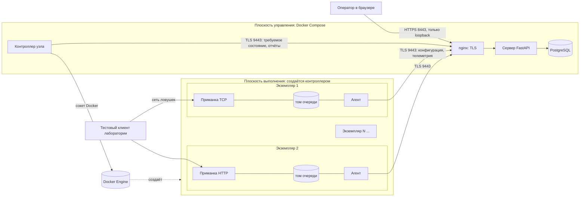
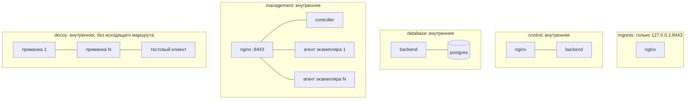
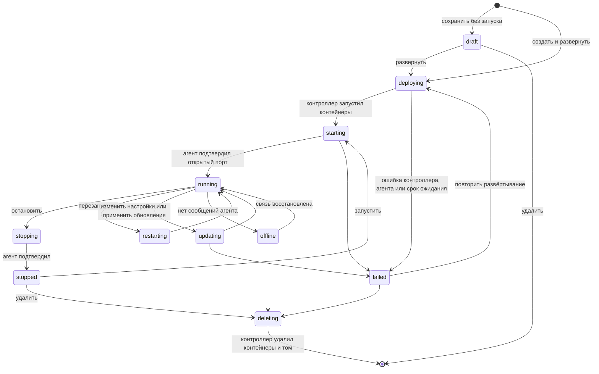
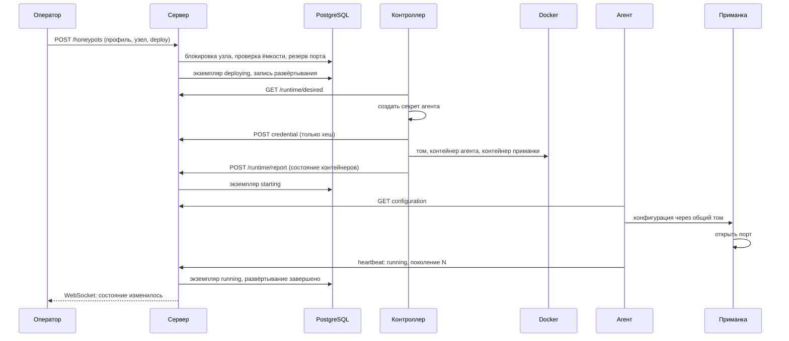
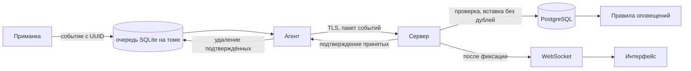

# Архитектура HoneyForge

HoneyForge разделён на плоскость управления и плоскость выполнения. Плоскость управления запускает Docker Compose. Ловушки в Compose не описаны: каждый экземпляр создаёт контроллер узла по требуемому состоянию из базы данных.

## Понятия

| Понятие | Что это | Где хранится |
|---|---|---|
| Тип сервиса | Реализованный эмулятор с набором настроек: `tcp-banner`, `http-admin`, `http-site`, `http-api` | Реестр в коде: `shared/catalog.py` |
| Профиль | Многократно используемый шаблон конфигурации. Ничего не запускает | Таблица `honeypot_profiles` |
| Экземпляр ловушки | Отдельная управляемая ловушка со своей конфигурацией, точкой подключения, агентом и историей | Таблица `honeypots` |
| Развёртывание | Запись о запросе запуска экземпляра и его результате | Таблицы `deployments`, `deployment_logs` |
| Среда выполнения | Два контейнера экземпляра (приманка и агент) и том очереди | Docker на узле; наблюдаемое состояние — в `honeypots.runtime` |
| Узел | Одобренный узел Docker с политикой ёмкости, которым управляет один контроллер | Таблица `hosts` |
| Агент | Машинное удостоверение одного экземпляра для канала управления | Таблица `agents` |

Один профиль может использоваться любым числом экземпляров. Экземпляр хранит снимок конфигурации (`configuration`), собранный из профиля и собственных настроек (`overrides`), поэтому изменение профиля не меняет работающие ловушки без явного действия.

## Компоненты

## Сети

Приманка подключена только к сети `decoy` и не получает ни секрета, ни адреса управления. Агент подключён только к сети `management`. Их связывает общий том с очередью SQLite. Контроллер подключён только к сети `management`, не имеет слушающих портов и единственный имеет доступ к сокету Docker.

## Реестр сервисов

`shared/catalog.py` перечисляет подключаемые модули сервисов. Каждый модуль задаёт ключ, название, уровень взаимодействия, образ, схему и значения по умолчанию, типы событий, возможности и способ проверки состояния. Три типа HTTP используют один эмулятор с разными декларативными страницами и маршрутами. Интерфейс показывает только реализованные типы. Добавление нового протокола описано в [руководстве разработчика](plugins.md).

Конфигурация описывается данными и проверяется схемой `ProfileSpec` из `shared/contracts.py`. Страницы HTTP состоят из шести безопасных компонентов и выводятся доверенными шаблонами с экранированием. Пользовательский текст никогда не выполняется как код, выражение шаблона или команда.

## Жизненный цикл экземпляра

Состояние хранится в `honeypots.status`. Переходные состояния ставит сервер при запросе операции; конечные — только по сообщению агента о применении нужного поколения конфигурации или по отчёту контроллера. Операция, которую никто не подтвердил за `OPERATION_TIMEOUT` секунд, переводится в `failed` с сохранением журнала. Повторный запрос уже выполненной операции ничего не меняет. Удаление во время незавершённой операции и любые операции во время удаления отклоняются.

## Развёртывание экземпляра

## Согласование состояния

Контроллер каждые две секунды сравнивает требуемое состояние с контейнерами, найденными по меткам `io.honeyforge.*`, а не по именам.

| Расхождение | Действие |
|---|---|
| Экземпляр должен существовать, контейнера нет | Контейнер создаётся заново; в аудит записывается `runtime.recovered` |
| Контейнер остановлен | Запускается повторно |
| Ограничения ресурсов отличаются от конфигурации | Применяются через обновление контейнера |
| Экземпляр в состоянии `deleting` | Удаляются контейнеры и том; после отчёта сервер удаляет запись и освобождает порт |
| Есть управляемые контейнеры без записи в базе | Удаляются как осиротевшие (`ORPHAN_POLICY=remove`) или только остаются на месте (`report`); в аудит записывается `runtime.orphan_removed` |
| Сервер управления недоступен | Контейнеры продолжают работать с последней конфигурацией; контроллер повторяет попытки |

После перезапуска сервера состав экземпляров берётся из базы данных, а контроллер продолжает отчитываться о тех же контейнерах: ничего не пересоздаётся.

## Точки подключения

Каждому экземпляру резервируется запись `network_endpoints`: псевдоним DNS в сети ловушек (`hp-` и первые восемь знаков идентификатора) и порт. Порт уникален в пределах узла и сети лаборатории. Это политика адресации: у каждого контейнера собственное сетевое пространство, и технически порты могли бы совпадать. Уникальность делает адрес однозначным и оставляет возможность публикации через шлюз. Поле `published_port` зарезервировано и не используется: сервисы намеренно не публикуются на интерфейсах узла.

Автоматический режим берёт порт профиля или ближайший свободный в диапазоне узла. Ручной режим принимает порт из диапазона и отклоняет занятый. Резервирование выполняется под блокировкой строки узла, поэтому одновременные запросы не получают одинаковый порт; уникальный индекс служит второй защитой.

## Ёмкость узла

Политика узла задаёт наибольшее число экземпляров, бюджет процессора и памяти и диапазон портов. Каждый развёрнутый экземпляр занимает ограничения приманки и парного агента (96 МБ и 0,25 ядра). Развёртывание, превышающее бюджет, отклоняется с объяснением на русском языке. Черновики занимают только порт.

## Телеметрия

Принадлежность события определяется удостоверением агента: сервер принимает события только для экземпляра, к которому привязан агент. Событие с чужим идентификатором ловушки отклоняет весь пакет. Повторная передача не создаёт дублей благодаря уникальности пары «агент, UUID события».

## Обновление конфигурации

Профиль имеет номер версии. Экземпляр хранит версию, из которой собран его снимок. После изменения профиля экземпляр с политикой «вручную» показывает, что доступно обновление, и применяет его по действию «Применить обновления». Экземпляр с политикой «автоматически» обновляется сразу. В обоих случаях сервер увеличивает поколение конфигурации, агент передаёт её приманке, приманка перезапускает слушающий сокет и подтверждает поколение. При ошибке применения восстанавливается прежний сокет, а экземпляр получает состояние `failed`.

## Расширение на несколько узлов

Узел — это контроллер со своим удостоверением и политикой ёмкости. `POST /api/v1/hosts` регистрирует дополнительный узел по хешу секрета контроллера. В поставке запускается и проверен один контроллер локального узла. Для удалённого узла потребуется доставить ему образ, сертификат удостоверяющего центра и сетевой доступ к каналу управления; это не входит в проверенную конфигурацию.
