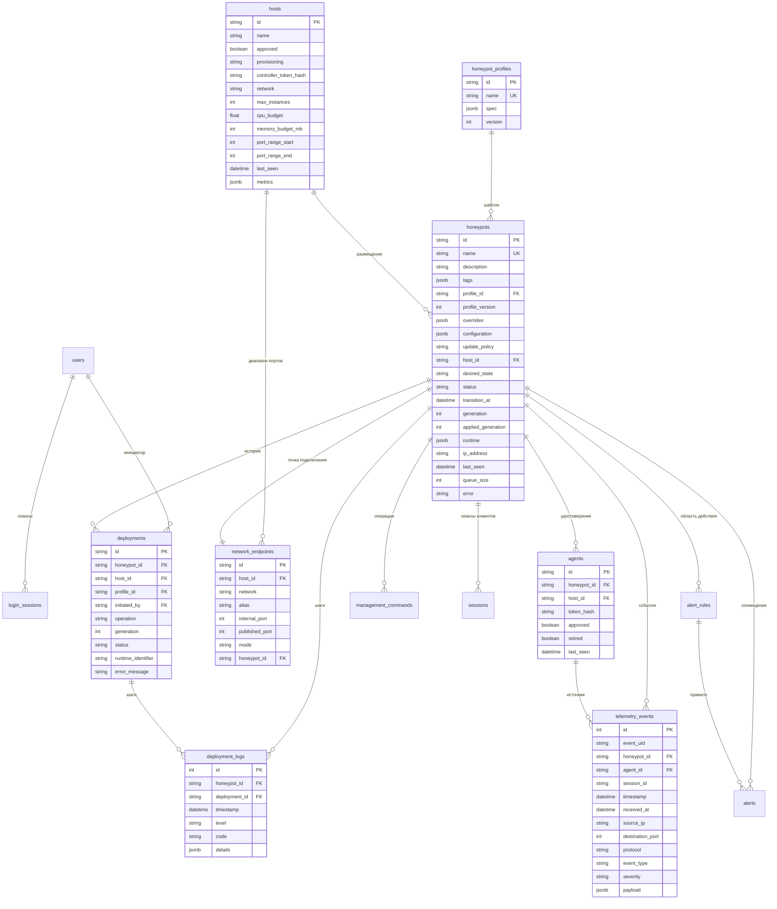

# База данных

Основное хранилище — PostgreSQL 16. Схему создают миграции Alembic из `backend/migrations/versions`; сервис `migrate` применяет их при каждом запуске Compose до старта сервера. Все отметки времени хранятся в UTC с часовым поясом.

## Схема

Таблицы `users`, `login_sessions`, `sessions`, `management_commands`, `alert_rules`, `alerts` и `audit_logs` не изменились по сравнению с первой версией.

Таблица `source_geo` (миграция `a3c9e1b72d54`) — кэш классификации и необязательной геолокации адресов источников. Она не связана внешними ключами с телеметрией и не изменяет события: адрес, тип (`public`, `private`, `loopback`, `reserved`), код и название страны, город, координаты, источник данных, время обогащения и срок действия.

## Что изменила миграция `e7a4d2c91f30`

| Таблица | Изменение |
|---|---|
| `hosts` | Удалён столбец `service_type` (узел больше не привязан к одному типу сервиса). Добавлены хеш секрета контроллера, сеть, политика ёмкости, диапазон портов, время последнего отчёта и измерения |
| `honeypots` | Снято ограничение уникальности `host_id`: на узле может быть много экземпляров. Добавлены описание, теги, версия профиля, собственные настройки, снимок конфигурации, политика обновления, время начала операции, наблюдаемое состояние контейнеров, время изменения |
| `agents` | Агент привязан к экземпляру (`honeypot_id`), а не к узлу. Снято ограничение уникальности `host_id`. Добавлены признак вывода из эксплуатации и время создания |
| `deployments` | Добавлены вид операции и идентификатор контейнера; инициатор может отсутствовать |
| `network_endpoints` | Новая таблица точек подключения |
| `deployment_logs` | Новая таблица шагов развёртывания и операций |

Типы сервисов хранятся не в таблице, а в реестре кода: добавить тип может только разработчик вместе с эмулятором, и таблица, редактируемая из интерфейса, создавала бы ложное впечатление настраиваемости.

## Ограничения целостности

- `honeypots.name` и `honeypot_profiles.name` уникальны.
- `network_endpoints`: уникальны пара «узел, сеть, порт» и пара «узел, сеть, псевдоним»; у экземпляра ровно одна точка подключения.
- `telemetry_events`: уникальна пара «агент, идентификатор события» — основа устранения дублей при повторной передаче.
- `sessions`: уникальна пара «ловушка, идентификатор сеанса».
- Внешние ключи связывают экземпляр с профилем и узлом, поэтому используемый профиль и занятый узел нельзя удалить.

## Перенос данных из модели двух слотов

Миграция не удаляет строки из `telemetry_events`, `audit_logs`, `users`, `honeypot_profiles`, `alerts` и `sessions`.

1. Создаётся узел `lab-docker` с контроллером. Хеш секрета контроллера сервер записывает при следующем запуске из переменной `CONTROLLER_TOKEN`.
2. Каждая существующая ловушка сохраняет идентификатор и переносится на узел `lab-docker`. Её конфигурация становится снимком конфигурации профиля, поколение увеличивается на единицу, состояние становится `deploying` или `stopping` в зависимости от требуемого.
3. Для каждой ловушки резервируется точка подключения с портом профиля. Если две ловушки использовали один порт на разных узлах, вторая получает следующий свободный.
4. Агенты слотов помечаются как выведенные из эксплуатации и теряют доступ. Строки остаются, потому что на них ссылаются сохранённые события.
5. Незавершённые команды и развёртывания закрываются; прежние узлы-слоты удаляются.

После запуска контроллер создаёт для перенесённых ловушек контейнеры и новые удостоверения агентов. Обратная миграция не поддерживается: для возврата восстановите резервную копию. Порядок обновления описан в [инструкции по миграции](migration.md).

## Срок хранения

Фоновая задача сервера удаляет события, сеансы клиентов и записи журнала развёртываний старше `RETENTION_DAYS` дней, а также истёкшие сеансы входа. Удаление экземпляра удаляет его события, сеансы, команды, развёртывания, оповещения, точку подключения и удостоверения агентов; запись об удалении остаётся в аудите.
